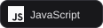
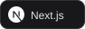
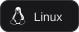
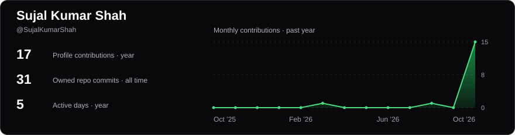
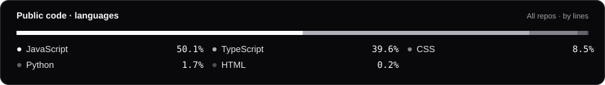
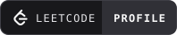
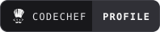

  <a href="https://sujal-kumar-shah.vercel.app/">
    <picture>
      <source media="(prefers-reduced-motion: reduce)" srcset="assets/readme/header-static@3x.png" />
      
    </picture>
  </a>

I'm **Sujal Kumar Shah**, a software developer focused on **C++ & algorithms**, **Linux systems**, and **React / Next.js** development. I like understanding how things work, solving problems, and turning what I learn into working projects. Open to **internships and collaboration**.

  

  
  
  
  
  
  
  
  

<!-- activity:start -->
### GitHub Analytics

  <a href="https://github.com/SujalKumarShah">
    <picture>
      <source media="(max-width: 600px)" srcset="assets/readme/activity-compact-4c295e37fce5.svg" />
      
    </picture>
  </a>

  <a href="https://github.com/SujalKumarShah?tab=repositories">
    <picture>
      <source media="(max-width: 600px)" srcset="assets/readme/languages-compact-a59aa15dd97b.svg" />
      
    </picture>
  </a>

<!-- activity:end -->

### What I'm working on

- **Problem solving:** practicing data structures and algorithms in C++, with solutions and learning progress on GitHub and coding platforms.
- **Web development:** building responsive interfaces with React, Next.js, TypeScript, and Tailwind CSS, including this portfolio.
- **Systems fundamentals:** exploring Linux, the command line, operating systems, and how software works beneath the interface.

I value readable code, a strong understanding of the fundamentals, and steady improvement. My portfolio brings together my projects, skills, and ways to get in touch.

### Connect with me

  
  
  
  
  

  

---

<strong>Thanks for stopping by.</strong> 
Understand first. Build second. Keep going.

