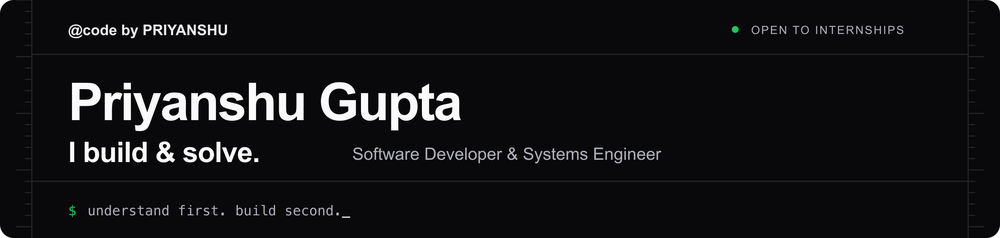
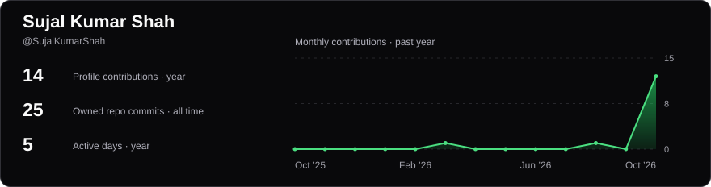
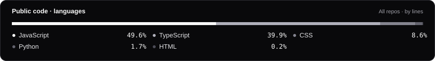

<p align="center">
  <a href="https://sujal-kumar-shah.vercel.app/">
    
  </a>
</p>

<p align="center">
  Building with <strong>React &amp; Next.js</strong> · Practicing <strong>algorithms</strong> · Exploring <strong>Linux</strong><br />
  <sub>Open to internships, collaboration, and open-source contributions.</sub>
</p>

<p align="center">
  <a href="https://sujal-kumar-shah.vercel.app/"><strong>Visit my portfolio ↗</strong></a>
  &nbsp; · &nbsp;
  <a href="mailto:sujalks6758@gmail.com">Get in touch</a>
</p>

## Toolkit

<p align="center">
  
  
  
  
</p>
<p align="center">
  
  
  
  
</p>

## Selected projects

| Project | What it does | Explore |
| :--- | :--- | :--- |
| **ABTalks 60-Day Challenge** | Hackathon app for daily coding challenges, streaks, and proof of work. | [Live ↗](https://hackathon-ab-talks.vercel.app) · [Code](https://github.com/SujalKumarShah/Hackathon-ab-talks) |
| **Developer Portfolio** | A Next.js home for my projects, skills, and public GitHub activity. | [Live ↗](https://sujal-kumar-shah.vercel.app) · [Code](https://github.com/SujalKumarShah/SujalKumarShah) |

## Currently learning

- **Problem solving:** practicing data structures and algorithms with solutions on GitHub and LeetCode.
- **Web development:** building responsive interfaces with React, Next.js, TypeScript, and Tailwind CSS, including this portfolio.
- **Systems fundamentals:** exploring Linux, the command line, operating systems, and how software works beneath the interface.

I value readable code, strong fundamentals, and steady improvement.

<!-- activity:start -->
## GitHub activity

<p align="center">
  <a href="https://github.com/SujalKumarShah">
    <picture>
      <source media="(max-width: 600px)" srcset="assets/readme/activity-compact-159e19aab062.svg" />
      
    </picture>
  </a>
</p>

<p align="center">
  <a href="https://github.com/SujalKumarShah?tab=repositories">
    <picture>
      <source media="(max-width: 600px)" srcset="assets/readme/languages-compact-81d6f301de62.svg" />
      
    </picture>
  </a>
</p>
<!-- activity:end -->

## Connect

<p align="center">
  <a href="https://github.com/SujalKumarShah"></a>
  <a href="https://www.linkedin.com/in/sujalkumarshah/"></a>
  <a href="mailto:sujalks6758@gmail.com"></a>
  <a href="https://leetcode.com/u/Sujalkumarshah/"></a>
  <a href="https://www.codechef.com/users/sujalkumarshah"></a>
</p>

<details>
<summary><strong>Run this portfolio locally</strong></summary>

### Development setup

Requires Node.js 22 or later and npm.

```sh
git clone https://github.com/SujalKumarShah/SujalKumarShah.git
cd SujalKumarShah
npm ci
npm run dev
```

Open <http://localhost:3000>. Use `npm run build` and `npm start` for a production build. Run `npm test`, `npm run lint`, and `npm run typecheck` to check changes.

Profile links and the deployment URL live in `public/profile.json`; project cards use `src/data/projects.json`. After updating either, run `npm run generate:agents` and `node scripts/generate-project-covers.mjs` to refresh public resources and covers.

The daily workflow refreshes GitHub statistics from the public portfolio endpoint. An optional server-side `GITHUB_TOKEN` increases API limits; never expose it with a `NEXT_PUBLIC_` prefix or commit it. See [README asset documentation](docs/README-ASSETS.md) for statistics scopes and regeneration steps.

</details>

---

<p align="center"><strong>Thanks for stopping by.</strong><br />
<sub>Understand first. Build second. Keep going.</sub></p>
